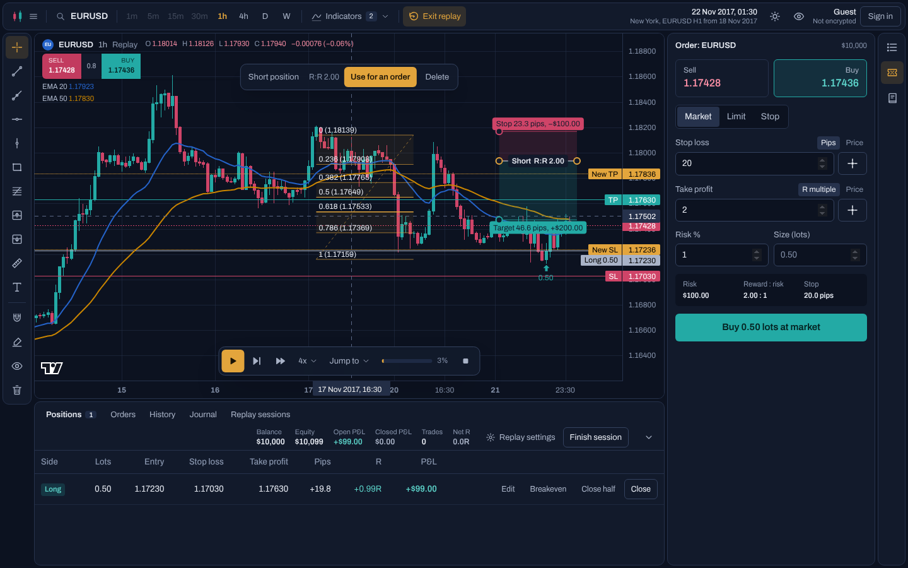
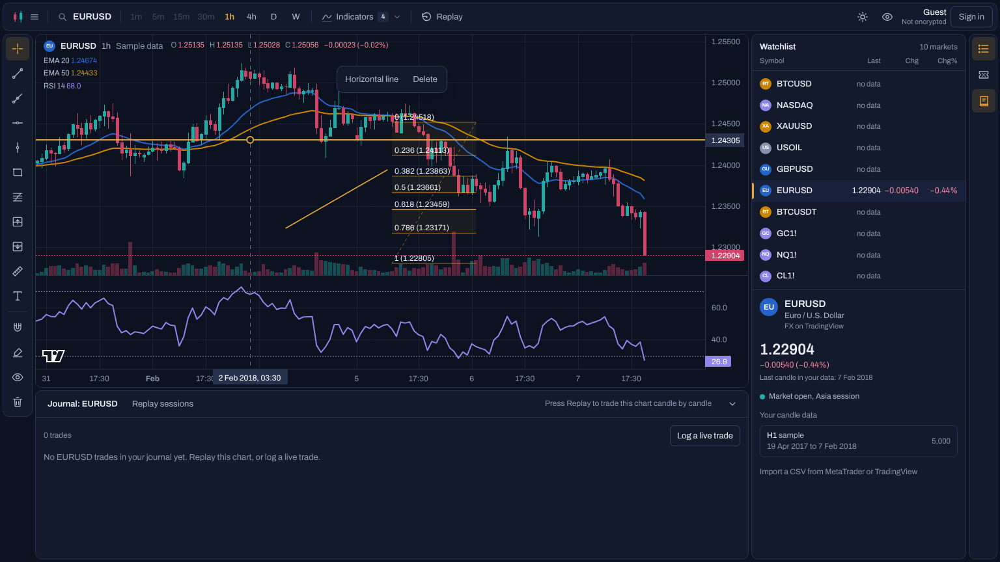
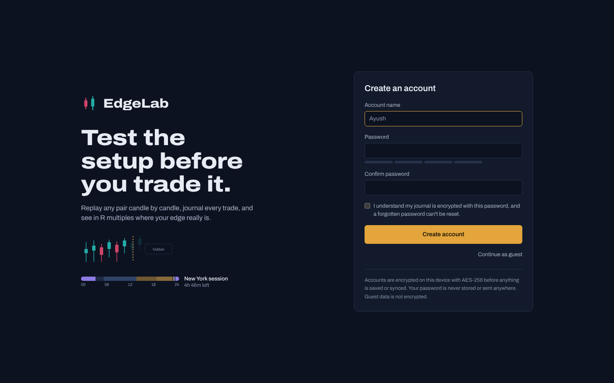
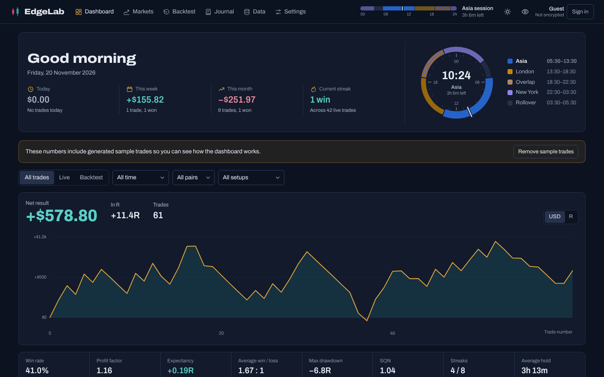
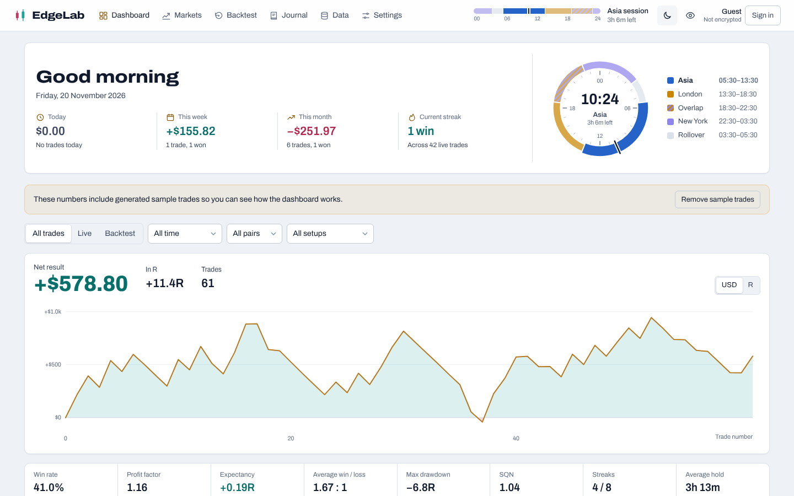
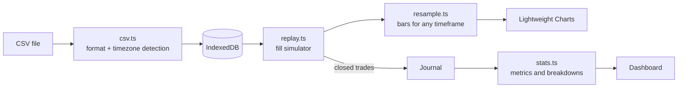

# EdgeLab

**Forex bar-replay backtesting and trading journal.** Replay any pair candle by candle with the future hidden, take trades with real spread, commission and risk-based sizing, then journal every live and backtested trade and see where your edge actually is. Live charts, one-click market data and password-protected, end-to-end encrypted accounts are built in.



## Features

**Chart terminal (laid out like the charting platforms traders already use)**
- Full-screen chart with a drawing toolbar on the left, symbol and timeframe bar on top, watchlist and order panel on the right, and a trading panel underneath.
- Drawing tools: trend line, ray, horizontal and vertical lines, rectangle, Fibonacci retracement, long and short position (risk / reward with pips and money), measure, and text notes. Magnet snapping, stay-in-drawing mode, hide and remove all. Drawings are painted inside the chart's own redraw, so they never lag when you scroll or zoom, and they keep their place across timeframes.
- Indicators: up to three EMA / SMA lines, Bollinger Bands, RSI in its own pane and volume.
- Watchlist with the trader's own markets: BTCUSD, NASDAQ (Nasdaq 100), XAUUSD, USOIL, GBPUSD, EURUSD, BTCUSDT, GC1! (gold futures), NQ1! (E-mini Nasdaq-100) and CL1! (crude oil futures), with last price and change from your data, and one-click download where a free source exists.



**Bar-replay backtesting**
- Press Replay and click the candle to start from (or pick a date). Future candles stay hidden. Step one candle at a time, play at 1 to 16 candles per second, or jump to the next London open, New York open or day.
- Replay any higher timeframe on top of lower-timeframe data. With M1 data on an H1 chart you can step minute by minute and watch the hourly candle form.
- Market, limit and stop orders with stop loss and take profit, set in pips, price, R multiples or by clicking the chart. Quick Buy / Sell buttons on the chart, and a long / short position drawing can fill the order panel for you.
- Lot size calculated from risk % and stop distance, including commission. Pip values are exact for USD-quoted and USD-based pairs and use a rate you can set for crosses; gold, silver, index and oil CFDs, CME futures (whole contracts) and NSE USDINR futures are built in.
- Partial closes, move to breakeven, edit SL/TP, max favourable and adverse excursion per trade.
- Sessions save automatically (with their drawings and notes) and resume on the exact candle.

**Live markets and data sync**
- A live TradingView chart with your own watchlist (forex, gold, oil, indices, futures, crypto), in your time zone.
- Download candles straight into a backtest dataset: crypto from Binance (free, no key) and forex from Twelve Data (free key). Up to 300,000 candles per download, with pagination, progress and a Stop button.
- An Update button fetches only the candles newer than the last one saved.
- A scrolling ticker tape of live prices for your watchlist.

**Accounts and privacy**
- Sign-in screen with password-protected accounts, plus a guest mode for demos. A guest journal can be moved into a new account in one step.
- Everything in an account (trades, sessions, settings, API keys) is encrypted on the device with AES-256-GCM; the key comes from the password via PBKDF2-SHA-256 with 600,000 iterations. The password is never stored.
- Synced copies are encrypted before they leave the device, so accounts follow you to other devices without the store ever seeing plaintext.
- Auto-lock after inactivity, a Lock button, a cooldown after repeated wrong passwords, and a hide-amounts mode that masks every money figure for screen recording.



**Journal**
- Every backtest trade lands in the journal automatically; live trades are logged by hand or imported from CSV.
- Journal right under the chart: each closed trade has a "Journal it" button, the session has its own plan-and-review notes, and your journaled trades show as markers on the chart.
- Record the setup, tags, mistakes (FOMO entry, moved SL…), emotion, a 1–5 execution rating, a TradingView screenshot link and notes.
- Search and filter by source, pair, setup and result. Export to CSV.

**Dashboard**
- A greeting with today's, this week's and this month's live P&L and your current win or loss streak.
- A 24-hour session clock in your time zone: Asia, London, the London–New York overlap and New York as arcs, with the time left in the current session (and when the market reopens at the weekend).
- Net P&L and R, equity curve, win rate, profit factor, expectancy, payoff ratio, max drawdown in R, $ and %, SQN, streaks and average hold time.
- Win-rate donut, R-multiple distribution with the average marked, and your most recent trades.
- P&L calendar with weekly totals.
- Breakdowns by setup, session, pair, weekday, direction and emotion.
- Backtest vs live comparison and the cost of each mistake.



**Day and night themes**
- Switch with the sun / moon button in the header or on the sign-in screen, or let it follow your device in Settings → Appearance. Charts, the TradingView widgets and the P&L colours all switch with it; profit and loss colours are checked for colour-blind separation on both themes.



## How the replay engine fills orders

The simulator lives in [`src/core/replay.ts`](src/core/replay.ts). It is plain TypeScript with no UI code, so it is unit-tested on its own.

- **Bid / ask.** Candle prices are bid prices. Buys fill at ask (bid + spread) and close at bid; sells fill at bid and close at ask. A short's take profit only fills when the *ask* reaches it.
- **Inside a candle.** Price is assumed to travel open → low → high → close for a bullish candle and open → high → low → close for a bearish one (the model MetaTrader 5 uses for "1 minute OHLC" testing). Every order and stop the path crosses is executed in the order price reaches it, so a buy stop can fill and hit its own take profit within one candle.
- **Gaps.** If the next candle opens beyond a stop or a pending order (weekend, news), it fills at the open price, with slippage, like a real market. Limit orders get the better price.
- **Lower-timeframe precision.** The cursor moves over the imported (base) candles, and higher timeframes are aggregated on the fly. Replaying H1 over M1 data therefore resolves SL/TP minute by minute instead of guessing inside a big candle.
- **No look-ahead.** The forming candle on the chart is built only from base candles up to the cursor, and the engine can never step backwards.



## Tech stack

| Layer | Choice | Why |
| --- | --- | --- |
| Language | TypeScript (strict) | One language for the engine and the UI; types catch pricing mistakes early |
| UI | React 19 + Vite | Fast dev loop, small production build |
| Charts | TradingView Lightweight Charts v5 | The candlestick engine traders already know; small and fast with large datasets |
| Styling | Tailwind CSS v4 | Design tokens in one place (`src/index.css`) |
| Storage | IndexedDB (`idb`) | Local-first: the journal lives on the trader's device; candles stored as packed `Float64Array`s |
| Security | Web Crypto API | PBKDF2-SHA-256 (600k iterations) key derivation and AES-256-GCM, with no crypto dependencies |
| Market data | Binance and Twelve Data REST, TradingView widget | Free sources that work from the browser, no backend needed |
| Tests | Vitest + Playwright | 74 unit tests (fills, gaps, spread, sizing, CSV formats, time zones, stats, sync, encryption, data providers, indicators, drawing tools) plus browser end-to-end runs |

## Getting started

```bash
npm install
npm run dev        # http://localhost:5173
npm test           # unit tests
npm run build      # production build in dist/
```

Deploy `dist/` to any static host: Vercel, Netlify or GitHub Pages (the build uses relative paths). `npm run build:single` produces one self-contained `dist-single/index.html`.

The app ships with an EURUSD H1 sample (Apr 2017 to Feb 2018) and a "sample journal" button on the empty dashboard, so you can try everything straight away.

## Getting data

- **Markets page (one click):** crypto from Binance with no key; forex from Twelve Data after you paste a free API key in Settings. The free Twelve Data plan allows 8 requests a minute and 800 a day; metals, oil and indices may need a paid plan.
- **MetaTrader 5:** Symbols window (Ctrl+U) → Bars → choose symbol and M1 → set dates → Request → Export Bars. MT5 timestamps are your broker's server time (usually UTC+2, or UTC+3 in summer); choose it in the import screen.
- **Dukascopy (free):** `npm run data -- --pair xauusd --from 2025-01-01 --to 2025-03-31 --tf m1` saves a UTC CSV in `data/`.
- **HistData.com:** monthly M1 files in Generic ASCII format. Their New York standard time stamps are converted to UTC automatically.

Import M1 and replay on M15, H1 or H4 for the most accurate fills.

## Project structure

```
src/
  core/           pure TypeScript, no React
    replay.ts       order and fill simulator
    resample.ts     timeframe aggregation, forming-bar logic
    csv.ts          candle file parser (MT4, MT5, Dukascopy, HistData, generic)
    sizing.ts       pip value, P&L conversion, lot size from risk
    stats.ts        expectancy, profit factor, drawdown, SQN, breakdowns
    time.ts         time zones, sessions in New York time, DST-safe conversions
    instruments.ts  contract specs (FX, metals, crypto, CFDs, CME futures, USDINR)
    indicators.ts   EMA, SMA, Bollinger Bands, RSI, ATR (incremental)
  terminal/       the chart workspace
    Terminal.tsx    layout, replay, orders, journal wiring
    drawings.ts     drawing tools: geometry, hit testing, chart painting
    useDrawingTool.ts  mouse and touch handling for drawing and dragging
    TopBar, ToolRail, Watchlist, OrderTicket, TradingPanel, ReplayBar, SymbolSearch
  store/          IndexedDB persistence, optional cloud mirror
  security/       password-based encryption, accounts
  market/         Binance and Twelve Data candle download
  state/          app state (React context)
  pages/          Dashboard, Markets, Journal, Data, Settings, Login
  components/     chart wrapper, calendar, trade form, UI kit
scripts/fetch-dukascopy.mjs   free data downloader
```

## Security model

- **Encrypted:** trades, replay sessions, settings and API keys of an account, both in IndexedDB and in any synced copy. Each record has its own random 96-bit IV; GCM authentication rejects tampered data.
- **Not encrypted:** account names, salts and check values (needed to unlock), and market data (candles are public information).
- **Protects against:** someone reading the browser storage of a shared or lost device, and the sync store reading your journal.
- **Does not protect against:** malware or a malicious extension on an unlocked device, or a weak password. There is no password reset: a forgotten password means the data cannot be decrypted.

## Design decisions

- **R multiples first.** Results are reported in R (risk units) next to money, so strategies can be compared regardless of account size or pair.
- **Sessions in New York time.** Asia, London, the London–New York overlap and New York are defined on New York clock hours, so daylight-saving changes move them correctly; everything is displayed in your own time zone.
- **Local-first.** No account and no server needed. The trade-off is that data lives in one browser, so Settings has backup export and restore.
- **Engine separate from UI.** The simulator and statistics are framework-free modules with their own tests, which keeps the trading logic easy to verify and reuse in a backend later.

## Roadmap

- Change password (re-encrypt every record under a new key)
- Backend (Node + PostgreSQL) for team accounts
- One-click import of MT4/MT5 account history reports
- Forward testing: run a replay session on live candles as they close
- Rule-based strategies that run over the data automatically, with Monte Carlo analysis of the results
- Chart screenshots stored with each journal entry
- Installable PWA for offline use

## Disclaimer

EdgeLab is a practice and review tool. Simulated results do not guarantee future performance.

## Credits

Charts by [TradingView Lightweight Charts™](https://github.com/tradingview/lightweight-charts) (Apache 2.0). Typeface [Archivo](https://github.com/Omnibus-Type/Archivo) (SIL Open Font License, see `src/assets/fonts`). Sample EURUSD data from the [backtesting.py](https://github.com/kernc/backtesting.py) project's test set.

## License

MIT
